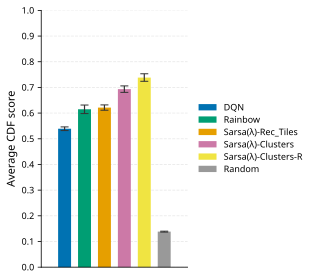
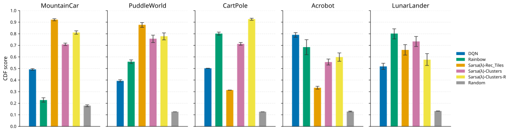
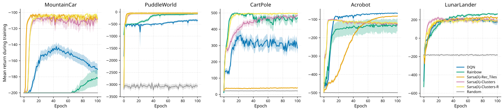
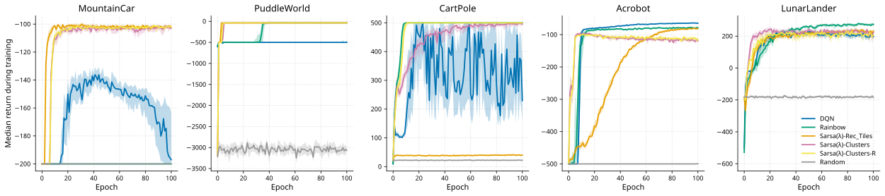

# Dynamic Tilings: Retraining Clustering-Based Features for Classical RL

This repository contains the code for my thesis: **a procedure for retraining a clustering-based feature representation during learning**, to be used with a linear function approximation algorithm.

The core idea is that clustering-based tilings can be retrained *while the agent is learning*, so that the representation follows the agent's visited state distribution instead of remaining fixed at initialisation. The claim is that this yields a more robust algorithm: one that performs well across multiple environments **without per-environment hyperparameter tuning**.

To assess this claim, everything is evaluated under the **Cross-environment Hyperparameter Setting (CHS) benchmark** (Patterson et al., 2024), in which each algorithm must use a **single hyperparameter configuration applied unchanged across all environments**. Measured performance therefore reflects robustness rather than the quality of environment-specific tuning.

## How it works

The representation mirrors tile coding: the state space is covered by *T* tilings, but each tiling is a *k*-means model with *k* clusters playing the role of tiles, so the partition is **learned from sampled states** rather than fixed on a regular grid. Within a tiling, a state belongs to exactly one cluster and is encoded as a one-hot vector; concatenating across tilings gives a sparse binary vector of dimension *T·k* with exactly *T* active entries. Each tiling is fitted on its own independently drawn state sample so that the tilings encode complementary information.

The exact encoding requires *T·k* distance computations per step, so the assignment function is approximated by a single **multi-head MLP**: a shared backbone with one linear head per tiling, trained as a supervised multi-task classifier on the same states used to fit the tilings. Its agreement with the exact k-means assignments stays above 0.95 throughout training, including after each retrain.

The defining feature is the **retraining event**: fresh states are sampled from the current policy, the scaler, the k-means models and the MLP are all refit, and the learned Q-function is re-projected onto the new feature basis by solving, in closed form, a ridge-regularised least-squares problem that makes the new representation reproduce the old Q-values. Retraining can fire on a fixed schedule or **when triggered by drift**: an increase of the mean assigned-centroid distance over a reference batch, i.e. a label-free signal that the tiling has gone stale for the distribution the agent now visits.

## Main results

All results below follow the CHS protocol: 48 candidate configurations per algorithm during selection, then **50 fresh seeds** for the final re-evaluation, on the Small Control set (Acrobot, CartPole, LunarLander, MountainCar, PuddleWorld).

Naming: **Sarsa(λ)-Clusters-R** is the proposed agent (dynamic tilings with retraining), **Sarsa(λ)-Clusters** is its no-retraining ablation, **Sarsa(λ)-Tiles** is the tile-coding baseline; DQN, Rainbow and Random keep their names.

**Aggregate CDF-normalised score** (averaged over environments and re-evaluation seeds, 95% bootstrap CIs). Two findings stand out:

1. the ablation *alone* already beats every external baseline, meaning the clustering representation is strong even fitted once and never revised;
2. retraining adds a statistically significant increment on top (non-overlapping CIs) at identical representation settings, which isolates the thesis's contribution.



**Per-environment CDF-normalised scores.** No algorithm wins everywhere, because a shared configuration forces trade-offs, but the two clustering agents never score below 0.55, while every external baseline drops below 0.40 somewhere. Their trade-offs are the mildest in the comparison.



**Learning curves** (mean evaluation return per epoch across the 50 re-evaluation runs, pointwise 95% bootstrap confidence bands; median variant below the mean one). The curves show that a low CDF score can conceal very different situations: on MountainCar DQN's and Rainbow's median runs never separate from the random policy, while on LunarLander all learning algorithms get close and the ranking separates agents whose outcomes differ only modestly. The two clustering-based agents end well above the random policy in **all five** environments.





**Bottom line:** under a single configuration shared across all five environments, the proposed agent attains the highest aggregate score and, together with its ablation, is the only algorithm to avoid outright failure everywhere; on top of that, it significantly improves over the no-retraining ablation.

The full analysis, including the transfer diagnostics (*rMAE*, *Preserved Greedy Actions*, *Cluster ARI*, *Weight Norm Ratio*), the batched-k-means refit and the drift trigger, is in the thesis.

## What's in this repo

```
src/dynamic_features/
├── launcher.py          # Hydra entrypoint for all experiments
├── configs/             # Hydra structured configs (per-algorithm defaults, envs, W&B)
├── experiments/         # Training loops: template-method base + per-algorithm classes
│   ├── baselines/       #   dqn, rainbow, sarsa_lambda_rec (tiles), random
│   └── dynamic_tiles/   #   sarsa_lambda_dt (the proposed agent)
├── methods/             # Feature representations
│   ├── baselines/       #  hashed tile coding (Sutton's tiles3)
│   ├── dynamic_tiles/   #  KMeansTilingFitter + ClusteringFeatures (+ MLP approximator)
│   └── utils.py         #   state-collection helpers
├── backbones/           # MultiHeadMLP approximator and its Trainer
└── results/             # Analysis scripts / marimo notebooks producing the thesis figures
tests/                   # Unit tests for the methods + (slow) end-to-end experiment tests
```

## Requirements

- [uv](https://docs.astral.sh/uv/) package manager
- Python 3.8 (the project pins `requires-python = "~=3.8.0"`)
- The Atari ROM handling dependency (`autorom[accept-rom-license]`) is installed automatically; `gym[box2d]` may require system packages (e.g. SWIG) on some platforms.

## Installation

```bash
git clone <this-repo>
cd Dynamic_features
uv sync
```

This creates a `.venv` with all pinned dependencies from `uv.lock`.

## Running an experiment

Navigate to `src/dynamic_features` and run `launcher.py`. It is configured via Hydra, so any value can be overridden from the command line. For example, a multirun DQN experiment over three seeds across the five CHS environments:

```bash
cd src/dynamic_features
uv run python launcher.py --multirun seed=0,1,2 \
    environment=Acrobot,PuddleWorld,MountainCar,LunarLander,CartPole \
    algorithm=dqn \
    wandb_log=True wandb.job_type="DQN_Run" wandb.mode="ONLINE"
```

The five algorithm configs are:

| `algorithm=` | What it is |
|---|---|
| `sarsa_lambda_dt` | **Proposed agent**: True Online Sarsa(λ) with dynamic clustering tilings |
| `sarsa_lambda_rec` | True Online Sarsa(λ) with standard hashed tile coding (baseline) |
| `dqn` | Deep Q-Network (baseline) |
| `rainbow` | Rainbow (baseline) |
| `random` | Uniform random policy (score contextualisation) |

The no-retraining ablation of the proposed agent is just `sarsa_lambda_dt` with `algorithm.agent.retrain_features=False`.

Useful overrides (see the config files in `src/dynamic_features/configs/experiments/` for the full set):

- `seed=<int or comma-separated list>`: reproducibility; each value runs a separate job under `--multirun`
- `algorithm.agent.retrain_trigger=INTERVAL,DRIFT`: retraining on a fixed epoch schedule or on quantisation-error drift
- `algorithm.train.n_epochs`, `algorithm.train.test_episodes`: reduce for a quick smoke test
- `wandb_log=<True|False>` and `wandb.mode=<ONLINE|OFFLINE>`: W&B logging is offline by default

## Reproducing the thesis runs

The figures above come from the CHS *re-evaluation* stage: the best configuration per algorithm (selected in the sweep stage) rerun with 50 seeds (`seed=100…149`), one job type per algorithm:

```bash
# Proposed agent
uv run python launcher.py --multirun seed=$(seq 100 149 | paste -sd, -) \
    environment=Acrobot,PuddleWorld,MountainCar,LunarLander,CartPole \
    algorithm=sarsa_lambda_dt \
    wandb_log=True wandb.job_type="sarsa_lambda_dt_final_v2"

# No-retraining ablation
uv run python launcher.py --multirun seed=$(seq 100 149 | paste -sd, -) \
    environment=Acrobot,PuddleWorld,MountainCar,LunarLander,CartPole \
    algorithm=sarsa_lambda_dt algorithm.agent.retrain_features=False \
    wandb_log=True wandb.job_type="sl_dt_noretr_final_v2"

# Tile-coding baseline
uv run python launcher.py --multirun seed=$(seq 100 149 | paste -sd, -) \
    environment=Acrobot,PuddleWorld,MountainCar,LunarLander,CartPole \
    algorithm=sarsa_lambda_rec \
    wandb_log=True wandb.job_type="sarsa_lambda_rec_final_v2"

# DQN
uv run python launcher.py --multirun seed=$(seq 100 149 | paste -sd, -) \
    environment=Acrobot,PuddleWorld,MountainCar,LunarLander,CartPole \
    algorithm=dqn \
    wandb_log=True wandb.job_type="DQN_final_v2"

# Rainbow
uv run python launcher.py --multirun seed=$(seq 100 149 | paste -sd, -) \
    environment=Acrobot,PuddleWorld,MountainCar,LunarLander,CartPole \
    algorithm=rainbow \
    wandb_log=True wandb.job_type="rainbow_final_v2"
```

## Producing the figures

The analysis notebooks in `src/dynamic_features/results/` fetch the completed runs from Weights & Biases and produce the thesis figures:

- `results/bootstrap_stats/bootstrap_statistics_v2.py`: bootstrap CDF scores and mean/median learning curves with 95% CIs → `plots_v2/*.svg` (the figures shown above)
- `results/hyperparameter_selection/hyperparameter_tuning_v2.py`: CHS selection stage, CDF-normalised ranking of hyperparameter configurations
- `results/metric_summary/metric_summary.py`: summary tables

They are [marimo](https://marimo.io) notebooks; open and run with:

```bash
uv run marimo edit src/dynamic_features/results/bootstrap_stats/bootstrap_statistics_v2.py
```

Note that they hardcode the W&B project/entity and the `job_type` names of the thesis runs, and need network access to the W&B API (plus your API key) to download the run histories.

## Tests

```bash
uv run pytest                                   # unit tests
uv run pytest -m "not benchmark and not slow"   # fast subset only
```

The slow tests run truncated end-to-end experiments across all algorithm/environment combinations; the benchmark tests use `pytest-benchmark`.

## License

MIT, see [LICENSE](LICENSE).
